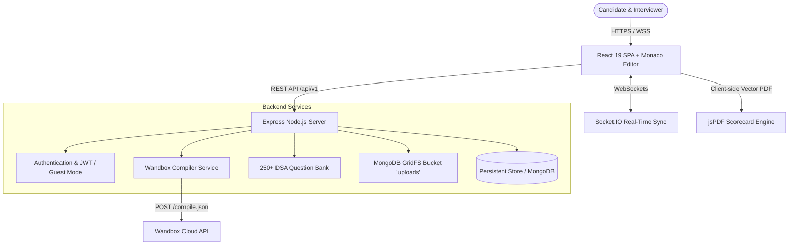
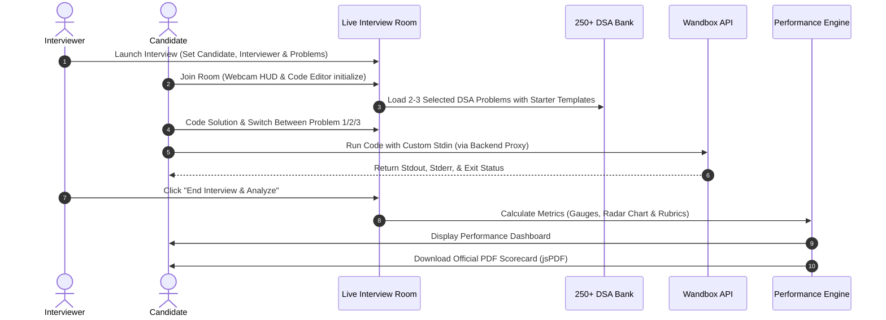

# ⚡ PairArena AI — Next-Gen Technical Interview & Collaborative Engineering Platform

<div align="center">

[](https://ais-pre-otong2oc2znsz2oekrjvel-653508992034.asia-southeast1.run.app)
[](https://opensource.org/licenses/MIT)
[](https://www.typescriptlang.org/)
[](https://react.dev/)
[](https://nodejs.org/)
[](https://www.mongodb.com/)

<p align="center">
  <b>A comprehensive, production-grade technical interview suite featuring a 250+ DSA question bank, live video recording preview HUD, synchronized Monaco code editor, cloud compilation via Wandbox, multi-problem in-session switching, circular and radar performance analytics, and instant downloadable PDF evaluation scorecards.</b>
</p>

[**🌐 Live Demo**](https://ais-pre-otong2oc2znsz2oekrjvel-653508992034.asia-southeast1.run.app) • [**Features**](#-key-features) • [**Tech Stack**](#-tech-stack) • [**Architecture & Flow**](#-architecture--system-flow) • [**Quick Start**](#-getting-started) • [**Author**](#-author--contact)

---

</div>

## 📌 Project Overview

**PairArena AI** bridges the gap between traditional coding challenges and real-world engineering interviews. It provides a full-fledged environment where interviewers and candidates can conduct live, structured interviews without friction. 

With **over 250 curated DSA problems across 18 algorithmic patterns**, candidates solve real problems in a real-time Monaco editor, compile code via Wandbox cloud execution, switch dynamically between 2–3 problems during the interview, and receive a rich post-interview analytical report with circular gauges, radar competency graphs, and one-click PDF downloads stored securely in MongoDB GridFS.

---

## 🛠 Tech Stack

### Frontend
-  **React 19** with TypeScript & Functional Hooks
-  **Vite** — Ultra-fast frontend build tooling and HMR
-  **Tailwind CSS v4** — Modern utility-first design system
-  **Monaco Editor (`@monaco-editor/react`)** — VS Code-grade code editor
-  **Recharts** — Radar charts, bar charts, and circular progress gauges
-  **Lucide React** — Modern, clean icons
-  **jsPDF** — Vectorized scorecard report generation

### Backend & Real-Time Engine
-  **Node.js** & **Express** REST API (`/api/v1`)
-  **TypeScript (`tsx`)** for end-to-end type safety
-  **Socket.IO** — Real-time bidirectional room synchronization
-  **Wandbox Execution Service** (`POST /compile.json`) for multi-language execution
-  **MongoDB GridFS (`uploads` bucket)** — Streamed file storage for avatars, reports, and recordings
-  **JWT & Bcrypt** — Secure token authentication with optional demo guest fallback

---

## ✨ Key Features

### 1. 🎯 250+ Curated DSA Problem Bank
- **18 Comprehensive Algorithmic Categories**:
  - Two Pointers, Sliding Window, Fast & Slow Pointers
  - Linked Lists & Reversals, In-place Manipulation
  - Trees, Binary Search Trees, BFS & DFS Traversals
  - Graphs, Dijkstra, Topological Sort, Union-Find
  - Dynamic Programming (1D, 2D, Knapsack, Subsequences)
  - Monotonic Stacks, Priority Queues / Heaps
  - Backtracking, Trie, Bit Manipulation, Math & Geometry
- **Multi-Language Starter Templates**: Ready-to-run boilerplate for Python 3, C++20, Java, JavaScript, and TypeScript.
- **Detailed Complexity Analysis**: Expected Big-O time and space complexity with hints.

### 2. 🎥 Live Technical Interview Room
- **Participant Cards**: Displays Interviewer details (Name & Lead Role) and Candidate profile with photo avatar.
- **Webcam Recording Preview HUD ("bgl mein recording")**:
  - Active real-time camera preview using browser `navigator.mediaDevices`.
  - Fallback animated simulated stream HUD for test environments without hardware access.
  - Recording indicator with live pulsing REC badge, duration timer, and mic/camera toggles.
- **Multi-Problem Switcher (2–3 Problems in Live Session)**:
  - Tab bar at the top of the coding panel lets candidates switch between 2 to 3 assigned problems instantly.
  - **"+ Pick from 250+ Bank"** searchable modal allows adding or swapping problems on the fly.
  - Editor state is preserved per problem, ensuring no code loss when toggling.

### 3. ⚡ Cloud Code Compiler (Wandbox)
- Server-side execution via Wandbox API (`https://wandbox.org/api/compile.json`).
- Official compiler identifiers: `gcc-head` (C++), `cpython-3.12.7` (Python), `nodejs-20.17.0` (JS), `typescript-5.6.2` (TS), and `openjdk-jdk-21+35` (Java).
- Standard input (`stdin`) tab, compiler stdout, stderr, execution time, and memory tracking.
- Automatic sandboxed fallback in case of public network rate limits.

### 4. 📊 Detailed Performance Analysis ("Graph & Circle ke Form Me")
- Triggered instantly via the **"End & Analyze"** button after completing an interview.
- **Circular Progress Gauges (`CircularGauge`)**:
  - Overall Performance Percentage (0–100%)
  - Data Structures & Algorithms Score
  - Code Quality & Cleanliness Score
  - Communication & Problem Solving Score
  - Execution Speed & Time Management
- **Competency Radar Chart**: Multidimensional comparison between the candidate's performance and the benchmark standard across 5 key pillars.
- **Time Allocation Chart**: Visual breakdown of time spent across each selected problem.
- **Rubric Breakdown**: Granular evaluation of correctness, edge-case coverage, and complexity optimality.

### 5. 📄 Instant PDF Scorecard & MongoDB GridFS Archival
- One-click **Download PDF Scorecard** powered by `jsPDF`.
- Generates an official technical evaluation certificate with scorecards, interview duration, timestamps, and interviewer recommendations.
- Automatically archives generated evaluation records to MongoDB GridFS.

---

## 🏗 Architecture & System Flow

### System Architecture


### Live Interview Session Flow


---

## 🚀 Getting Started

### Prerequisites
- **Node.js**: v18.0.0 or higher
- **npm** or **bun**

### 1. Clone the Repository
```bash
git clone https://github.com/your-username/pairarena-ai.git
cd pairarena-ai
```

### 2. Install Dependencies
```bash
npm install
```

### 3. Environment Configuration
Create a `.env` file in the root directory:
```bash
cp .env.example .env
```

Ensure your `.env` contains:
```env
PORT=3000

# Existing MongoDB Connection (for GridFS and data storage)
MONGODB_URI=your_existing_mongodb_connection_string

# Code Execution Provider (Wandbox)
CODE_EXECUTION_PROVIDER=wandbox
WANDBOX_BASE_URL=https://wandbox.org/api

# File Storage Provider (MongoDB GridFS bucket 'uploads')
STORAGE_PROVIDER=gridfs
```

### 4. Run the Development Server
```bash
npm run dev
```

The application will start at `http://localhost:3000`.

---

## 🔑 Pre-Configured Demo Accounts

For quick local testing, you can use the pre-seeded accounts or continue in **Instant Guest Access Mode**:

| Role | Email | Password |
| :--- | :--- | :--- |
| **Lead Interviewer** | `alex.chen@pairarena.dev` | `DemoPassword123!` |
| **Senior Candidate** | `elena@pairarena.dev` | `DemoPassword123!` |

*(Guest access is also automatically enabled with zero login barriers).*

---

## 📡 API Overview

| Method | Endpoint | Description |
| :--- | :--- | :--- |
| `GET` | `/api/v1/problems` | List problems from the 250+ DSA question bank |
| `GET` | `/api/v1/problems/:slug` | Retrieve problem details, starter templates & test cases |
| `POST` | `/api/v1/compiler/run` | Execute code using Wandbox Cloud Compiler |
| `GET` | `/api/v1/interviews` | List live and past interview rooms |
| `POST` | `/api/v1/interviews` | Create and launch a new live interview session |
| `GET` | `/api/v1/interviews/:id` | Get room data, assigned problems, and participants |
| `POST` | `/api/v1/interviews/:id/switch-problem` | Switch or add problem from the 250+ bank during interview |
| `POST` | `/api/v1/interviews/:id/feedback` | Submit interview evaluation and generate scorecard |
| `POST` | `/api/v1/storage/upload` | Stream file upload to MongoDB GridFS `uploads` bucket |
| `GET` | `/api/v1/storage/file/:fileId` | Download file from GridFS with ownership verification |

---

## 📜 License

This project is open-source and distributed under the **[MIT License](LICENSE)**.

```
MIT License

Copyright (c) 2026 Sonu Kumar

Permission is hereby granted, free of charge, to any person obtaining a copy
of this software and associated documentation files (the "Software"), to deal
in the Software without restriction, including without limitation the rights
to use, copy, modify, merge, publish, distribute, sublicense, and/or sell
copies of the Software, and to permit persons to whom the Software is
furnished to do so, subject to the following conditions:

The above copyright notice and this permission notice shall be included in all
copies or substantial portions of the Software.
```

---

## 👨‍💻 Author & Contact

**Sonu Kumar**  
Full-Stack Software Engineer & AI Systems Developer

- 🌐 **Live Demo:** [Live Demo](https://ais-pre-otong2oc2znsz2oekrjvel-653508992034.asia-southeast1.run.app)
- 💼 **Portfolio:** [https://animated-portfolio-pro.vercel.app/](https://animated-portfolio-pro.vercel.app/)
- 🔗 **LinkedIn:** [https://www.linkedin.com/in/sonu-kumar-3234bb344/](https://www.linkedin.com/in/sonu-kumar-3234bb344/)
- ✉️ **Email:** [sonukr7435@gmail.com](mailto:sonukr7435@gmail.com)

---

<div align="center">
  <sub>Built with ❤️ by Sonu Kumar for engineers aiming for top-tier technical interviews.</sub>
</div>
